<p align="center">
  
</p>

<h1 align="center">List Reminder</h1>

<p align="center">A quiet place for your to-dos, right on your Mac desktop.</p>

<p align="center">macOS 26+ · Apple Silicon · Swift / AppKit / SwiftUI</p>

<p align="center"><a href="README.md">中文</a> · English</p>

List Reminder is a minimal native macOS to-do app with a Liquid Glass desktop widget. Organize tasks in the main window, place the widget where it fits, and double-click a row to complete it.

## Download

Open **[Releases](https://github.com/DavidJiang1121/List-Reminder-Mac-Widget/releases/latest)** and download `List-Reminder-macOS-arm64.zip`. Unzip it, move **List Reminder.app** to Applications, and open it.

Requires an **Apple Silicon Mac** running **macOS 26 or later**. The current build is ad-hoc signed and has not been notarized by Apple.

## Features

- **Desktop to-dos** that stay available after closing the main window.
- **Double-click to complete** in both the app and widget. Clicking the widget does not open the main window.
- **Calendar countdowns** with optional due dates: red for overdue, orange for today or `1d`–`3d`, and green from `4d` onward.
- **Homework and categories**: filter the main list by category. Homework rings match the color of their due dates.
- **Daily repeats** use a translucent pink-to-yellow badge. Finish one today and it returns tomorrow.
- **Achievements** show 365 days of completed tasks in an interactive GitHub-style heatmap.
- **Focused desktop quick add** from a floating Liquid Glass **+** that does not reserve a list row. The editor opens at screen center with a dimmed, animated star field.
- **Full-screen fireworks** and a “完成了！！！” (Completed!) animation when a task is completed. The overlay fades out after about three seconds and does not intercept mouse input.
- **All-clear celebration**: the last completion triggers ten seconds of champagne, fireworks, nebulae, and expanding waves.
- **Native Liquid Glass** powered by `NSGlassEffectView`, with adjustable background transparency and fully readable text.
- **Adjustable layout** with drag-to-move, corner resizing, presets, and width/height controls.
- **Position lock** to prevent accidental dragging and corner resizing while keeping task completion available.
- **Minimal appearance** with neutral colors, no orange decorations or persistent hints, and light/dark/system modes.
- **Task management** with editing, deletion, completed history, and undo for the most recent task change.
- **Local storage** without an account or network connection. Tasks, appearance, position, and lock state are saved automatically.

## Usage

1. Open the add form from the main window or the widget’s **+**. Choose a category and optionally set a calendar due date or enable daily repeat.
2. Double-click a row in the app or widget to complete it. Double-click a completed task in the app to restore it.
3. Open **小组件外观** (Widget Appearance) to adjust transparency, dimensions, and color scheme.
4. Drag the widget into place, then enable **锁定位置** (Lock Position).
5. Close the main window and keep using the desktop widget. Reopen the app from the Dock or menu bar when needed.

The widget is an app-managed desktop window, rather than a WidgetKit gallery extension. It sits below regular app windows. When locked, it can still be resized from the main app's settings.

The current interface is in Chinese; this English README explains the key controls.

## Data

```text
~/Library/Application Support/List Reminder/reminders.json
```

Back up or move the entire data folder to preserve tasks and settings. Writes are atomic. Unreadable files are backed up before replacement; if the backup fails, writing stops to preserve the original.

Updates preserve tasks, settings, and existing dated completions. Clearing completed one-time tasks keeps their achievement history. No personal task data is included in the repository or release archive.

## Build

Install full Xcode with a macOS 26+ SDK, then run:

```sh
chmod +x build.sh test.sh
./build.sh
./test.sh
```

The app is generated at `build/List Reminder.app`. The build script generates the icon, compiles for arm64, applies an ad-hoc signature, and verifies it.

See **[development notes](docs/DEVELOPMENT.md)** for the source map and validation details. Report bugs and suggestions through **[Issues](https://github.com/DavidJiang1121/List-Reminder-Mac-Widget/issues)**.
